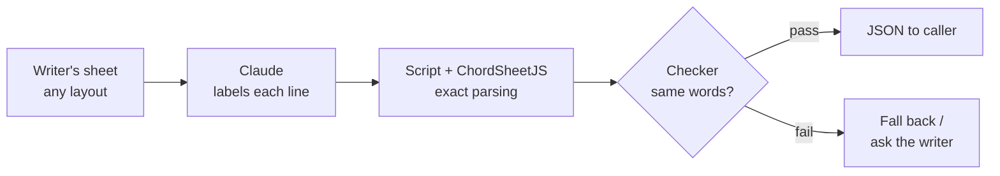

# Design notes: Lyrics & Chords skill

Started 9 Oct 2026 · @Andrew

Working notes. Decisions are Andrew's; everything else is a proposal.

## TODO

- **Reorganise these notes by topic (asked 17 Oct 2026).** The sections are in the order the ideas came up, with bug reports, decisions and dated updates mixed together, so a reader has to hunt. Regroup by subject: what the skill does, the formats it reads and the repairs made, how failures are reported (the error principle), outputs (JSON, text, `lyrics-only`), what was learned from real files, and what is decided, deferred or open. Keep each decision's date and who made it. Take out what later notes replaced (for example the web-source material, now dropped). Do this as its own step, with no change to what the notes say.

## Purpose

Read lyric and chord sheets in many layouts and return one normalised JSON structure, or say plainly what could not be resolved. It is a helper for the Songwriting Coach (a separate, proprietary skill, which must work fully without it) and is useful on its own.

## Decided

- **The song object is ChordSheetJS's own JSON** (`{ "type": "chordSheet", "lines": [...] }`), exactly as `load` returns it in `song`. We do not define a schema of our own, and the Songwriting Coach has no JSON of its own yet, so the Coach adapts to this one (Andrew, 9 Oct 2026). Annotations use what that JSON already has: the `annotation` field on a chord-and-lyric item, and `comment` tags. This closes the "options on hold" question below.

- Separate public open-source skill, built on ChordSheetJS (9 Oct 2026).
- Name: "Lyrics & Chords"; slug and repo `lyrics-and-chords`. The slug has no ampersand because skill names allow only lowercase letters, numbers and hyphens.
- Licence: GPL-2.0-only (9 Oct 2026). ChordSheetJS 18.0.0 is GPL-2.0-only (checked in its `package.json` and LICENSE file), so the bundled whole is distributed under version 2. The processor's own code matches, which avoids a mixed "only" and "or later" position. If ChordSheetJS is ever dropped, the licence of our own code can be revisited (we are the only author). Not legal advice.
- The Songwriting Coach never bundles this code. It uses the skill only if installed.
- Optional use between skills works: in the Calc test (9 Oct) a skill named another skill, used it when present, and said so when absent without inventing a result.
- No scraping or bulk download of lyrics or charts: the skill never crawls, searches or collects. No copyrighted lyrics in this repo; test charts are scrubbed first, and the saved Genius samples are out-of-copyright songs.
- `load(url)` fetches the one page whose address the user gives (9 Oct 2026). Making sure they may use it is the user's responsibility, and the skill says so. This replaces the earlier "never fetches anything" rule.

## Facts about ChordSheetJS (checked 9 Oct 2026)

- Version 18.0.0, GPL-2.0-only, no runtime dependencies (`jspdf` is optional, for PDF output).
- Parsers: ChordPro, chords over words, Ultimate Guitar text. No parser for saved web pages, Word files or plain unlabelled lyrics.
- A minified single-file bundle of the chords-over-words parser and the ChordPro formatter was about 290 KB (esbuild, scratch test).
- The full package is 38 MB unpacked; only a bundle would ship.
- Runs on Node 16 or later. Not yet checked: whether claude.ai's code environment has Node.

## Central idea: Claude for the fuzzy part, a script for the exact part

Lyric and chord sheets come in too many layouts for one parser. ChordSheetJS reads three well-formed layouts (ChordPro, chords over words, Ultimate Guitar text) and nothing else. Test on 9 Oct 2026, a plain lyric sheet with ALL CAPS headers: it parsed without error and kept every lyric word, but it missed the title, treated the credit and key/tempo lines as lyrics, and left the sections as loose comment lines.

So the skill combines two kinds of strength:

- **Claude (flexible, trainable):** recognises the layout, tells titles, metadata, headers, chord lines and lyrics apart, labels sections, spots unlabelled repeats, and asks the writer when unsure.
- **The script and library (exact, repeatable):** reads the sheet the same way every time, keeps the lyric text unchanged, builds the JSON, and checks the result against the original.



The weak point is the handoff from Claude to the script. If Claude retypes the lyrics, it can change a word, a line break or a chord without anyone noticing. The checker exists to catch that.

Open choice (not decided): Claude only **labels** each line (title, metadata, header, chord line, lyric) and the script does all the copying and restructuring, so Claude never retypes the lyrics; or Claude **rewrites** the sheet into a layout ChordSheetJS reads. Labelling is the safer starting point, because the lyric text always comes from the writer's own file.

The claim is testable: take messy layouts (the 11 scrubbed samples, plus the writer's own lyrics) and measure whether the structure comes out right with zero changed lyric words.

## Web pages: song data versus site noise

A saved or pasted web page mixes three layers: the lyrics, facts about the song, and noise from the site. Only the first two are wanted. Findings from the Genius test (9 Oct 2026, see `test-report-genius.md`): the page carries its data as embedded JSON (`window.__PRELOADED_STATE__`) and as meta tags, with no JSON-LD and no link to a JSON file. The embedded lyrics are cleaner than the visible page text.

**Keep (song data):**
- Title
- Artist names
- Writers (and producers, if it is cheap to get)
- Album
- Release date
- Language
- Key and tempo, if the site has them (Genius's page did not)
- Copyright notice for the song, if the source has one. It is never asked of the user (decided 9 Oct 2026): if the source lacks it, it stays empty. The Genius pages tested (4) had none in their data; the "© 2026 ML Genius Holdings" in the page footer is the site's own notice and must never be taken as the song's.

**Ignore (decided 9 Oct 2026):**
- YouTube, Spotify and Apple Music ids
- Performance credits (including label names)
- Explicit and instrumental flags
- Recording location
- Page views and "hot" score; contributor, comment, annotation and similar counts
- Ad targeting and tracking data
- Share messages, images and links
- Verification flags and the viewer's own permissions
- Translations and related songs

This is a per-site choice. For a site we don't know, Claude decides which text is lyrics, which is song data and which is noise, and asks when unsure.

## ChordPro in the wild (tested 9 Oct 2026)

Eight ChordPro files from Andrew's own collection went through `scripts/parse.mjs`: two standard samples, one of Andrew's songs, and five `.pro` cover-song charts. Only structure was inspected; the cover charts are copyrighted and none of their content is kept here. All eight parsed without an error and were detected as ChordPro, but the results differ.

**Standard files work.** Tags, inline chords and closed sections came out correctly.

**One of Andrew's own ChordPro files:**
1. Two `{title}` lines: the second holds the credit, date and version ("Music & Lyrics: Name - date (v2)"). It should become credits, date and version facts.
2. `Time: 4/4 (...)` is written without braces, so it was read as a lyric line and not as the `time` fact.
3. Sections are opened (`start_of_verse`, `start_of_chorus`) and never closed. ChordSheetJS accepts that; the next start implies the end.
4. Every section, including Intro, Post, Bridge and Outro, is a `start_of_verse` tag. The real section type is only in the name.
5. Each line is a row of chords in bars, then spaces, then the lyric text. The library attached all the chords to the start of the line and read the `|` bar marks as lyric text, so chord positions were lost.

**The `.pro` cover charts (no lyrics):**
1. They are bar charts: a plain-text section label (`Verse 1 - quiet`) then bars (`| Am C | D G |`). ChordSheetJS read everything, bars included, as lyric lines, and found no chords.
2. Square brackets hold performance notes as well as chords: `[XXX add some horns?]`, `[*** USE VOLUME CONTROL ***]`, `[Esus to Em to Esus riff]`, `[LOW-C Breakdown]`. All were parsed as chords. The library does not check that a bracket holds a chord name.
3. Chart shorthand passes through as text: `V`, `^CC`, `\\`, `....`, `/ / /`, `Solo x16`, `Repeat x16`, and half-written lines like `| Am...`.
4. Non-standard directives `{songpartname: ...}` and `{image: "..."}` come out as tags. The image paths are local file paths and must not be carried into any output.

**What follows from this (proposals unless marked):**
- "What is a lyric line" needs more than the library offers. Claude's labelling and our own rules supply it.
- Treat bracket content as a chord only if the library's chord parser accepts it; otherwise it is a note. (Proposal.)
- Closing a section at the next section start is the rule for files with no end tags. (Proposal.)
- Ignore `songpartname` and `image`; drop the image paths. (Proposal.)
- A second `{title}` that looks like a credit line is split into credits, date and version. (Proposal.)
- A bare `Time:` or `Key:` line outside braces is a fact. (Proposal.)
- **Decided 9 Oct 2026:** bar charts with no lyrics are out of scope. `load` raises a plain error and returns nothing (see `functions.md`). They are a third kind of input beside lyrics with chords and chords over words, and ChordSheetJS cannot read them.

## Layers

1. **Library (ChordSheetJS):** ChordPro, chords over words, Ultimate Guitar text, inline chords; formatting back out.
2. **Our code (deterministic):** header handling (bracketed, bare, ALL CAPS), plain lyrics in blocks, saved Ultimate Guitar and Chordie pages, clutter from pasted text, line classification, numbering, the JSON, and the checker that compares output to the input.
3. **Model (fuzzy):** what an odd label means, labelling unlabelled sections, lyric or annotation, asking the writer when unsure.

The lyric text is always copied from the input by a script, never retyped by the model.

## Contract with the Songwriting Coach

- The Coach sends raw text or a file path, optionally a format hint, and gets back JSON with a `schema_version`, or an error object.
- The Coach tolerates missing fields and older versions.
- The Coach compares the JSON's lyric lines with the writer's text. Any mismatch, error or empty result means it uses its own path.
- A skill cannot be queried; the model sees the skills available in the session. So the Coach's instruction is "if a lyrics and chords skill is available, use it".
- The description must say what this skill does (parse and convert lyric and chord files) without matching ordinary songwriting requests, which belong to the Coach.
- Everything runs locally, except `load(url)` fetching the one page the user gave.

## Platforms

- claude.ai and Claude Code can hold both skills. ChatGPT and Gemini cannot rely on it.
- ChordSheetJS is JavaScript; `npm install` at run time cannot be relied on, so ship one bundled script inside the `.skill`.

## Draft JSON

Starts from the Coach's existing `parse` output (see the Songwriting Coach repo, `todo/lyric-sheet-skill-spec.md`).

```json
{
  "schema_version": "0.1",
  "title": "...",
  "format_detected": "chordpro | bracketed | allcaps | plain | ultimate_guitar | chords_over_words | html | docx",
  "metadata": { "artist": "...", "key": "...", "tempo": "...", "capo": "...", "credits": ["..."] },
  "sections": [
    { "label": "[Verse 1]", "code": "V1", "confidence": "high",
      "lines": [ { "n": 1, "text": "...", "chords": [ { "at": 4, "symbol": "Am" } ], "annotations": ["x2"] } ] }
  ],
  "unparsed_blocks": [],
  "requires_llm": false,
  "parse_notes": []
}
```

Section codes (V1, Ch1...) are not needed: the Songwriting Coach does not need normalised section names (decided 9 Oct 2026). Ideas to settle: line numbers restarting in each section; chord position as column or character offset; keeping the original layout so it can be written back; original text next to normalised text; a confidence per section; a list of questions for the writer.

## Test material (no lyrics)

- Scrubbed samples live in the Songwriting Coach repo (`scratch/scrub-check/`, 11 files; made by `tests/samples/scrub_charts.py`). They are gitignored there; copy them across when needed. Originals (with real words) must never be committed.
- Public domain ChordPro and layout samples are in that repo's `tests/samples/`.
- Plan: run the samples through ChordSheetJS and chord-mark (MIT, a possible cross-check) and the Coach's `parse`; build golden JSON per sample; test the checker with deliberate mismatches.

## Not decided

- JSON schema details.
- v1 input list: saved HTML pages, Word, Nashville?
- Output beyond JSON (ChordPro or plain text for pasting)?
- Node bundling method, and whether Node exists in claude.ai's code environment.
- Chord positions as columns or offsets; how repeated sections are stored.
- How much interpretation lives here and how much stays in the Coach.
- Maintenance: tracking ChordSheetJS updates and keeping the schema version in step with the Coach.

## Bug found in use: headers that name a performer (9 Oct 2026)

A Genius page whose headers carry a performer (`[Verse 1: Name]`) failed to load. Findings, from reproducing it:
- The chord readers were the wrong tool: Genius text has no chords, yet a name ending in "B" (a chord letter) or a two-word ad-lib line was read as chords. The Ultimate Guitar reader lost an ad-lib line that way; ChordPro read every header as a chord and `check` passed it.
- `check` also over-counted: it treated the "B" inside `[Verse 1: Name B]` as a chord.
- Fixes: web pages are read with a `lyrics-only` reader that never produces chords (`[Label: performers]` gives the section "Label" plus a `comment` with the performers); `check` counts a bracket as chords only if every word in it is a chord, flags `not-a-chord` and `sections-missing`; in Ultimate Guitar style a lone `[B]` or `[A]` is a header.
- `tests/lyrics-and-chords.test.mjs` covers all of this with invented lyrics. A real page is never a fixture.

## Word files, labels without brackets, and priorities (10 Oct 2026)

- **Word files:** read for their text only (Andrew: keep it simple). One line per paragraph, a tab as a space; comments, deleted text, formatting and styles are ignored. `read-docx.mjs` unpacks the zip itself (no dependency). Tables, heading styles and font-dependent chord alignment are not used.
- **Found by running the real Word files:** section labels written as `V1`, `V2` or `CHORUS` were read by the chord readers as chords (`V1` became a `V` chord and a `1`) and lost; the Ultimate Guitar reader drops chord lines made of bar marks (`| Ebmin7 | Db6/F |`). Now such labels are put in brackets (wording kept) and turned into sections while the chords-over-words reader keeps its chord lines. The library also gives up on a whole chord line if one chord is unknown (`G(maj7)`); parse reads such a line as chords again.
- **Nashville numbers (tested with a chart made from a public-domain song):** a ChordPro file with number chords is read correctly, but `check` rejects the numbers as "not a chord", and the chords-over-words version loses its chord lines. Real Nashville charts are usually bars with no lyrics, which are out of scope. Not built.
- **Andrew's priorities:** 1. fetching a page from a web address (built for Genius). 2. finding a song's lyrics from a title and artist (for example, to study a named song). Saved pages are not important.
- **Finding a song by name (decided 10 Oct 2026):** Claude uses its own web search to find the Genius page, tells the user which page it will load, then calls `load` with the address and checks that title and artist match the request. The scripts never search and never guess an address. It is an instruction in `SKILL.md` ("Finding a song by name"), not code, so it needs testing by hand in a real session. For a copyrighted song the lyrics are not printed in the conversation: they are saved, formatted and with chords if any, to a file and opened for the user (`load --save default --open`, 10 Oct 2026). `default` is the user's Documents folder, which has the same name on macOS and Windows (Desktop, then the home folder, if there is none); where an environment provides its own folder for the user's files, that is used instead. No assumption about the user's setup. The file name comes from the title and artist, and an existing file is never replaced.

### Run on 104 of Andrew's own Word files (10 Oct 2026)

The first real-world corpus. Result after the fixes above: 90 of 104 load; the other 14 fail loudly (never silently).
- 5 files (versions of two songs) have a `[ that is never closed on a bar line. A real error in the file; the message names the line.
- 9 files have chord lines with a word in them (`Intro | Gm79 | C7`). Not handled: read as lyric lines and flagged by `check`.
- What the corpus taught: the library's chord reading cannot be trusted line by line (it rewrites `maj7`/`♭`, drops lines on one unknown chord, and its Ultimate Guitar reader drops bar-line chord lines and takes CHORUS for a chord). So chord lines it does not return exactly are read by this skill, and the Ultimate Guitar style is read with the chords-over-words reader plus sections built here.
- A file in a Dropbox cloud folder can take a minute to open the first time (it is downloaded then). Not a skill fault; `load` limits each step to two minutes.

## Deferred (10 Oct 2026, Andrew)

- **A verified-guess fallback for finding a song by name:** if Claude's web search finds no Genius page, build the address from the artist and title and load it, with `load` failing if the page's title and artist differ from the request. It would reverse the current "never guess an address" rule, so it is not built. Finding by search alone often fails, because the search tool cannot see genius.com; until then the user gives the address (or the text).
- **Nashville numbers** (a ChordPro file with number chords is read, but `check` rejects the numbers; the plain-text version loses its chord lines).
- **Charts with no lyrics** (bars and section labels only): they load as junk, with no error.
- **Chord lines that contain a word** (`Intro | Gm79 | C7`): read as lyric lines, and `check` says so (9 of 104 Word files).

## Web sources dropped (10 Oct 2026, Andrew)

The skill works on files, not on web pages. Fair-use concerns were blocking too much (printing or saving the lyrics of copyrighted songs, searching for songs, fetching pages). The mission is: load a reasonable range of lyric files, parse them, clean up or correct where needed, and return a JSON object.

- **Removed:** fetching a web address, the Genius page reader (`read-page.mjs`), "Finding a song by name", the copyrighted-song rule, and the claim that the network is used once. The skill now makes no network requests. All of it is in git history (commits `0da0e57`, `677e4be`) if it is ever wanted again.
- **Kept:** every file reader and repair, `check`, `set-aside`, facts, Word files, pasted text, `--save` and `--open` (a readable copy of the loaded song), and the `lyrics-only` reader (text with `[Header]` lines and no chords, used when asked for with `--format lyrics-only`).
- **The three out-of-copyright Genius samples** stay in `tests/samples/genius/` as plain test text.
- Items above that mention fetching, Genius or finding a song by name are superseded by this section.

## Design principle: errors are for writers (10 Oct 2026, Andrew)

Lyric files are written by people who are thinking about the song, not about file formats. They deviate from the "correct" format in more ways than we can list. So:

1. **Do not write a repair for one writer's typo.** A parser that fixes the specific mistakes found in the test files may not work on the next person's files. It also changes their text on a guess. Repairs are for safe, general cases (padding spaces, a section that is never closed), and each is reported in `notes`.
2. **Give a good error for the rest.** An error should tell the writer three things, in plain words, with no jargon:
   - **Which file**, if that is not obvious. (`load` names it; pasted text has none.)
   - **Which line**, or the general area if the line is not certain.
   - **What we think the problem is, and how sure we are**: precise ("line 29 has a `[` that is never closed", *very likely*), a guess ("possibly"), or only "look at this line and the one before it".
3. **Say it before the jargon.** The reader's own detail (line, column, what it found, what it expected) goes last, for those who want it.
4. **Never be sure when we are not.** A vague message that is true is better than a precise one that sends the writer to the wrong place.
5. **Test the message, not the file.** Tests use invented text that shows the kind of mistake (an unclosed `[`), so the message is checked to work in general.

First use: the parse error (`explain()` in `scripts/parse.mjs`; the file name is added in `scripts/load.mjs`). The same principle applies to the other failures: `check` problems, set-aside refusals, unreadable Word files, and any later error. Where an existing message does not yet follow it, it is a bug in the message.

Found by: five of Andrew's Word files had a chord line starting with `[` instead of `|`. The old message pointed at the line above; the new one names the right line. No special repair was added.

First review against the principle (10 Oct 2026, obvious cases only): `load` answered a missing file with a Node stack trace, and loaded an empty file, a PDF or an RTF file as if it were a song. It now says in plain words what is wrong (no such file, a folder, empty, a PDF, an old Word .doc, an RTF, not text) and what to do. Usage errors for Claude (a bad option, bad facts) were left as they are: they are not shown to a writer.

## Bug found in use: unbracketed "Label: Performer" headers (10 Oct 2026)

Reported from the Coach side, with a minimal repro. All four points were true.
1. `Verse 1: Singer A` (no brackets) was read by the library as a comment, and `Outro: Singer B` as a metadata tag named Outro. No sections, no error. Cause: the bare-label pattern allowed a colon only at the end of the line. It now allows a short performer part after the colon (not a sentence).
2. `Pre-Chorus: Singer A` was read as a chord over a lyric, and `check` failed the load safely. Same fix.
3. `check` counted only `[Header]` lines for `sections-missing`. It now also counts unbracketed headers, against the larger of the two kinds (a whole-line `[note]` is not always a header).
4. `format --as text` put the performer on its own line. New `--as lyrics-only` writes `[Label: Performer]` on one line (the full output spec, from the Coach's request, is in functions.md under `format`).

Not done: guessing `lyrics-only` as the format for a sheet with no chords. The sections come out right either way.

Run on the 103 Word files after the change: the same 14 fail as before. Four more fail by design: Word's temporary lock files (`~$name.docx`) are now refused as "does not look like a text file" instead of being read as a song.

## Bug found in use: bar charts, headers with a note, held chords (15 Oct 2026)

Reported from the Coach side after loading a pasted song (invented words are used in the tests).
1. **Bar charts were placed on words.** A chart line (`|  C  |  G  |`) directly above a lyric line was attached to it by column, so the chart was cut across the words. Now any chord line that has `|` bars is kept as chord-only line(s) and the lyric below stays plain. Bar marks are kept as items of the chord line so the line can be written back as written.
2. **`[VERSE 5] (sung quietly)` was a lyric line**, so Verse 5 fell inside the section before it. A header followed by a note wrapped in `( )` or `[ ]` is now a header, and the note is a `comment` straight after the section start (as a performer is). Other text after a header is not touched: it might be a lyric.
3. **A hold mark (`G …`, `G…`, `G..`) turned a chord line into a lyric line.** The hold mark is now part of the chord line and joins the chord before it, written as it was (`"G …"`); `check` accepts it. The library's `annotation` field was not used because its formatters lose it.

Side effect on the Word files: the five files that failed with chord lines now load (their bar lines were the problem), so 8 of 103 fail now: the 4 Song A files with the unclosed `[` and the 4 `Song B` files with a chord line that contains a word.

Not changed, from the same report: (a) a fact line after the last section (`Acknowledgements: ...`) stays inside that section's tags; the facts are not lost and `lyrics-only` writes them first. (b) A `-` for an empty bar is kept as an item named `-`, as `|` is; both are marks, not chord names, and `check` accepts them.

## Facts after the last lyric line (17 Oct 2026, unreleased)

A fact written at the end of the song (`Acknowledgements: ...`, `Copyright: ...`) sat inside the last section's tags. It is now moved up with the other facts at the top, in the order found, and `parse` says so in a note. Only fact tags move: the known fact names and "Label: value" lines the reader made into tags. Sections, comments and directives stay put, and so does a fact in the middle of the song (a `key` or `capo` there can mean a change at that point). `check` is unaffected. Of the 103 Word files, 1 had such a line.

## Plain messages for a failed check (17 Oct 2026, unreleased)

The four `Song B` files failed because a chord was written with a space inside it (`C /F`). The old output was a list of kinds (`missing`, `not-a-chord`, a leaked internal marker), no help to a writer. Following the error principle above, every problem from `check` now carries a plain `message`: the line quoted with its number, what happened to it, and a general list of what to look for. A hint about which word is probably the culprit is added only when the line is mostly chords with one or two words that are not (it then says "probably"). No message is written for one particular typo, because the ways a file can be wrong are many; the same three parts are given for every kind of problem. Related leftovers (`"/F" is part of the problem above`) say there is nothing more to fix.

The leaked marker: a line the skill does not take for chords sat directly above a chord line it had set aside, so the library laid chords over the marker text. The message for that case says the line was mixed up with a nearby line, and to look at the lines just above and below.

