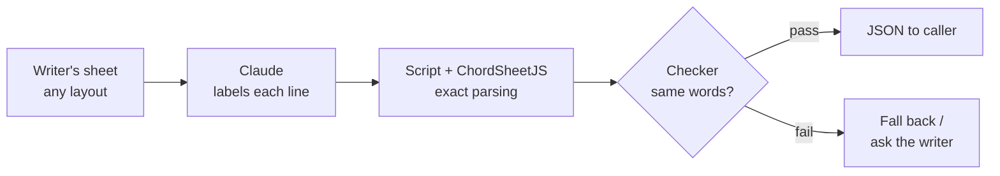

# Design notes: Lyrics & Chords skill

Started 9 Oct 2026 · @Andrew

Working notes. Decisions are Andrew's; everything else is a proposal.

## Purpose

Read lyric and chord sheets in many layouts and return one normalised JSON structure, or say plainly what could not be resolved. It is a helper for the Songwriting Coach (a separate, proprietary skill, which must work fully without it) and is useful on its own.

## Decided

- Separate public open-source skill, built on ChordSheetJS (9 Oct 2026).
- Name: "Lyrics & Chords"; slug and repo `lyrics-and-chords`. The slug has no ampersand because skill names allow only lowercase letters, numbers and hyphens.
- Licence: GPL-2.0-only (9 Oct 2026). ChordSheetJS 18.0.0 is GPL-2.0-only (checked in its `package.json` and LICENSE file), so the bundled whole is distributed under version 2. The processor's own code matches, which avoids a mixed "only" and "or later" position. If ChordSheetJS is ever dropped, the licence of our own code can be revisited (we are the only author). Not legal advice.
- The Songwriting Coach never bundles this code. It uses the skill only if installed.
- Optional use between skills works: in the Calc test (9 Oct) a skill named another skill, used it when present, and said so when absent without inventing a result.
- No scraping or bulk download of lyrics or charts: the skill never crawls, searches or collects. No copyrighted lyrics in this repo; test charts are scrubbed first, and the saved Genius samples are out-of-copyright songs.
- `load(url)` fetches the one page whose address the user gives (9 Oct 2026). Making sure they may use it is the user's responsibility, and the skill says so. This replaces the earlier "never fetches anything" rule.

## Facts about ChordSheetJS (checked 9 Oct 2026)

- Version 18.0.0, GPL-2.0-only, no runtime dependencies (`jspdf` is optional, for PDF output).
- Parsers: ChordPro, chords over words, Ultimate Guitar text. No parser for saved web pages, Word files or plain unlabelled lyrics.
- A minified single-file bundle of the chords-over-words parser and the ChordPro formatter was about 290 KB (esbuild, scratch test).
- The full package is 38 MB unpacked; only a bundle would ship.
- Runs on Node 16 or later. Not yet checked: whether claude.ai's code environment has Node.

## Central idea: Claude for the fuzzy part, a script for the exact part

Lyric and chord sheets come in too many layouts for one parser. ChordSheetJS reads three well-formed layouts (ChordPro, chords over words, Ultimate Guitar text) and nothing else. Test on 9 Oct 2026, a plain lyric sheet with ALL CAPS headers: it parsed without error and kept every lyric word, but it missed the title, treated the credit and key/tempo lines as lyrics, and left the sections as loose comment lines.

So the skill combines two kinds of strength:

- **Claude (flexible, trainable):** recognises the layout, tells titles, metadata, headers, chord lines and lyrics apart, labels sections, spots unlabelled repeats, and asks the writer when unsure.
- **The script and library (exact, repeatable):** reads the sheet the same way every time, keeps the lyric text unchanged, builds the JSON, and checks the result against the original.



The weak point is the handoff from Claude to the script. If Claude retypes the lyrics, it can change a word, a line break or a chord without anyone noticing. The checker exists to catch that.

Open choice (not decided): Claude only **labels** each line (title, metadata, header, chord line, lyric) and the script does all the copying and restructuring, so Claude never retypes the lyrics; or Claude **rewrites** the sheet into a layout ChordSheetJS reads. Labelling is the safer starting point, because the lyric text always comes from the writer's own file.

The claim is testable: take messy layouts (the 11 scrubbed samples, plus the writer's own lyrics) and measure whether the structure comes out right with zero changed lyric words.

## Web pages: song data versus site noise

A saved or pasted web page mixes three layers: the lyrics, facts about the song, and noise from the site. Only the first two are wanted. Findings from the Genius test (9 Oct 2026, see `test-report-genius.md`): the page carries its data as embedded JSON (`window.__PRELOADED_STATE__`) and as meta tags, with no JSON-LD and no link to a JSON file. The embedded lyrics are cleaner than the visible page text.

**Keep (song data):**
- Title
- Artist names
- Writers (and producers, if it is cheap to get)
- Album
- Release date
- Language
- Key and tempo, if the site has them (Genius's page did not)
- Copyright notice for the song, if the source has one. It is never asked of the user (decided 9 Oct 2026): if the source lacks it, it stays empty. The Genius pages tested (4) had none in their data; the "© 2026 ML Genius Holdings" in the page footer is the site's own notice and must never be taken as the song's.

**Ignore (decided 9 Oct 2026):**
- YouTube, Spotify and Apple Music ids
- Performance credits (including label names)
- Explicit and instrumental flags
- Recording location
- Page views and "hot" score; contributor, comment, annotation and similar counts
- Ad targeting and tracking data
- Share messages, images and links
- Verification flags and the viewer's own permissions
- Translations and related songs

This is a per-site choice. For a site we don't know, Claude decides which text is lyrics, which is song data and which is noise, and asks when unsure.

## ChordPro in the wild (tested 9 Oct 2026)

Eight ChordPro files from Andrew's own collection went through `scripts/parse.mjs`: two standard samples, one of Andrew's songs, and five `.pro` cover-song charts. Only structure was inspected; the cover charts are copyrighted and none of their content is kept here. All eight parsed without an error and were detected as ChordPro, but the results differ.

**Standard files work.** Tags, inline chords and closed sections came out correctly.

**Andrew's own file ("Dawn and Dusk"):**
1. Two `{title}` lines: the second holds the credit, date and version ("Music & Lyrics: Name - date (v2)"). It should become credits, date and version facts.
2. `Time: 4/4 (...)` is written without braces, so it was read as a lyric line and not as the `time` fact.
3. Sections are opened (`start_of_verse`, `start_of_chorus`) and never closed. ChordSheetJS accepts that; the next start implies the end.
4. Every section, including Intro, Post, Bridge and Outro, is a `start_of_verse` tag. The real section type is only in the name.
5. Each line is a row of chords in bars, then spaces, then the lyric text. The library attached all the chords to the start of the line and read the `|` bar marks as lyric text, so chord positions were lost.

**The `.pro` cover charts (no lyrics):**
1. They are bar charts: a plain-text section label (`Verse 1 - quiet`) then bars (`| Am C | D G |`). ChordSheetJS read everything, bars included, as lyric lines, and found no chords.
2. Square brackets hold performance notes as well as chords: `[XXX add some horns?]`, `[*** USE VOLUME CONTROL ***]`, `[Esus to Em to Esus riff]`, `[LOW-C Breakdown]`. All were parsed as chords. The library does not check that a bracket holds a chord name.
3. Chart shorthand passes through as text: `V`, `^CC`, `\\`, `....`, `/ / /`, `Solo x16`, `Repeat x16`, and half-written lines like `| Am...`.
4. Non-standard directives `{songpartname: ...}` and `{image: "..."}` come out as tags. The image paths are local file paths and must not be carried into any output.

**What follows from this (proposals unless marked):**
- "What is a lyric line" needs more than the library offers. Claude's labelling and our own rules supply it.
- Treat bracket content as a chord only if the library's chord parser accepts it; otherwise it is a note. (Proposal.)
- Closing a section at the next section start is the rule for files with no end tags. (Proposal.)
- Ignore `songpartname` and `image`; drop the image paths. (Proposal.)
- A second `{title}` that looks like a credit line is split into credits, date and version. (Proposal.)
- A bare `Time:` or `Key:` line outside braces is a fact. (Proposal.)
- **Decided 9 Oct 2026:** bar charts with no lyrics are out of scope. `load` raises a plain error and returns nothing (see `functions.md`). They are a third kind of input beside lyrics with chords and chords over words, and ChordSheetJS cannot read them.

## Layers

1. **Library (ChordSheetJS):** ChordPro, chords over words, Ultimate Guitar text, inline chords; formatting back out.
2. **Our code (deterministic):** header handling (bracketed, bare, ALL CAPS), plain lyrics in blocks, saved Ultimate Guitar and Chordie pages, clutter from pasted text, line classification, numbering, section codes, the JSON, and the checker that compares output to the input.
3. **Model (fuzzy):** what an odd label means, labelling unlabelled sections, lyric or annotation, asking the writer when unsure.

The lyric text is always copied from the input by a script, never retyped by the model.

## Contract with the Songwriting Coach

- The Coach sends raw text or a file path, optionally a format hint, and gets back JSON with a `schema_version`, or an error object.
- The Coach tolerates missing fields and older versions.
- The Coach compares the JSON's lyric lines with the writer's text. Any mismatch, error or empty result means it uses its own path.
- A skill cannot be queried; the model sees the skills available in the session. So the Coach's instruction is "if a lyrics and chords skill is available, use it".
- The description must say what this skill does (parse and convert lyric and chord files) without matching ordinary songwriting requests, which belong to the Coach.
- Everything runs locally, except `load(url)` fetching the one page the user gave.

## Platforms

- claude.ai and Claude Code can hold both skills. ChatGPT and Gemini cannot rely on it.
- ChordSheetJS is JavaScript; `npm install` at run time cannot be relied on, so ship one bundled script inside the `.skill`.

## Draft JSON

Starts from the Coach's existing `parse` output (see the Songwriting Coach repo, `todo/lyric-sheet-skill-spec.md`).

```json
{
  "schema_version": "0.1",
  "title": "...",
  "format_detected": "chordpro | bracketed | allcaps | plain | ultimate_guitar | chords_over_words | html | docx",
  "metadata": { "artist": "...", "key": "...", "tempo": "...", "capo": "...", "credits": ["..."] },
  "sections": [
    { "label": "[Verse 1]", "code": "V1", "confidence": "high",
      "lines": [ { "n": 1, "text": "...", "chords": [ { "at": 4, "symbol": "Am" } ], "annotations": ["x2"] } ] }
  ],
  "unparsed_blocks": [],
  "requires_llm": false,
  "parse_notes": []
}
```

Ideas to settle: line numbers restarting in each section; section codes (Intro, V1.., Ch1.., Pre, Post, Brg, Brk, Solo, Outro, Tag, Hook; repeats numbered); chord position as column or character offset; keeping the original layout so it can be written back; original text next to normalised text; a confidence per section; a list of questions for the writer.

## Test material (no lyrics)

- Scrubbed samples live in the Songwriting Coach repo (`scratch/scrub-check/`, 11 files; made by `tests/samples/scrub_charts.py`). They are gitignored there; copy them across when needed. Originals (with real words) must never be committed.
- Public domain ChordPro and layout samples are in that repo's `tests/samples/`.
- Plan: run the samples through ChordSheetJS and chord-mark (MIT, a possible cross-check) and the Coach's `parse`; build golden JSON per sample; test the checker with deliberate mismatches.

## Not decided

- JSON schema details.
- v1 input list: saved HTML pages, Word, Nashville?
- Output beyond JSON (ChordPro or plain text for pasting)?
- Node bundling method, and whether Node exists in claude.ai's code environment.
- Chord positions as columns or offsets; how repeated sections are stored.
- How much interpretation lives here and how much stays in the Coach.
- Maintenance: tracking ChordSheetJS updates and keeping the schema version in step with the Coach.
